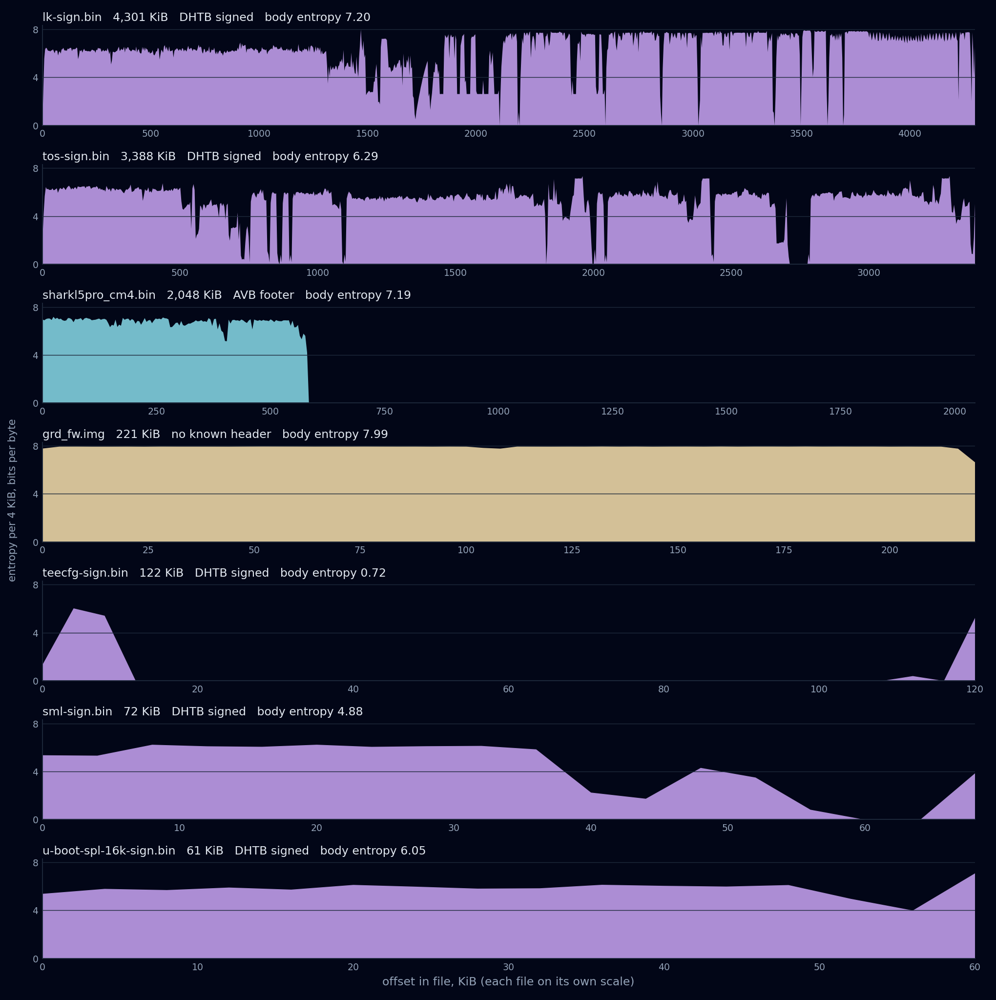
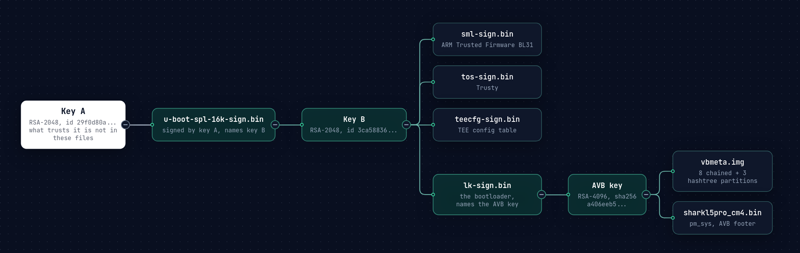

# tab-a8-firmware

A static read of the stock firmware on a **Samsung Galaxy Tab A8 (SM-X200)**, the tablet that took [LineageOS](https://lineageos.org), next to the phone that wouldn't.

Animated sheet drawn with [blueprint](https://github.com/intincrab/blueprint) by intincrab (MIT).

**The read is in**: the firmware's layout, verified boot, why a GSI (a generic system image: one Android build made to run on many devices) fits, the bootloader's signing chain and its first two stages, and the secure world. There's a LineageOS how-to from two real flashes too. What's still open is listed at the end of each section of the [teardown](Tab-A8-teardown.md).

The short of it: on this tablet the bootloader doesn't decide alone. It asks a **secure world** (Trusty) whether the unlock is genuine and whether the boot image passes, and sets the boot colour from the answers. The A10e kept those decisions in `sboot`, the part you can read.

New to this? [The plain version](Tab-A8-teardown.md#the-plain-version) is six short points with no addresses.

## What it found (short version)

- **None of the signed bootloader files is encrypted.** The A10e's `sboot` had an encrypted stage at the front. Here the five signed files hash to the value in their own headers, and four of the five are full of ARM64 code and plain strings. One other file, `grd_fw.img`, sits at the maximum the whole way through, and what it's for isn't known.

- **The files sign each other, and you can see it without a disassembler.** One key signs the first loader, which names the key for the next four files, and the bootloader names the key for the Android images.

- **Unlocking isn't a flag the bootloader just believes.** The switch in Developer options is one byte, but the unlock itself is a record the secure world recomputes and compares whenever the bootloader asks.

- **The secure world is Trusty, and apps are fenced away from it.** The hop into it and its key derivation weren't read, and the picture says so.

- **A current GSI fits because the vendor's Treble level is one the GSI still ships.** The A10e's wasn't. The two are side by side in [why a GSI fits](Tab-A8-teardown.md#why-a-gsi-fits).

The full read, with addresses and the command behind each claim, is the [teardown](Tab-A8-teardown.md). Its last section lists the [sources and tools](Tab-A8-teardown.md#sources-and-tools).

## What this is for

The sibling to [a10e-firmware](https://github.com/CassieFox23/a10e-firmware), a phone that's locked down and stays on stock. The Tab A8 went the other way and runs a LineageOS GSI, so this asks the same questions of the tablet and puts the answers [side by side](A8-vs-A10e.md):

- What does the bootloader check before it boots something, and what changes once it's unlocked?
- What does verified boot ([AVB](https://android.googlesource.com/platform/external/avb/)) do on this one?
- Why does a GSI fit here when it couldn't on the A10e?
- What's the secure world on this chip, and what keeps apps away from it?

## What's in here

| Path | What it is |
|---|---|
| [`Tab-A8-teardown.md`](Tab-A8-teardown.md) | The write-up |
| [`A8-vs-A10e.md`](A8-vs-A10e.md) | The tablet next to the phone |
| [`docs/lineageos-howto.md`](docs/lineageos-howto.md) | LineageOS on the tablet: what was done, and what wasn't tested |
| [`docs/partition-map.md`](docs/partition-map.md) | All 58 partitions from the PIT |
| [`docs/how-the-code-was-read.md`](docs/how-the-code-was-read.md) | The tools that read the bootloader and the secure world |
| [`docs/what-it-took.md`](docs/what-it-took.md) | Tool calls, tokens and an API-price cost estimate for building the repo |
| [`tools/`](tools/README.md) | Eleven small scripts |
| `figures/` | The pictures: charts drawn by `tools/`, diagrams from the pages below |
| `.archify/` | Eight diagrams as standalone pages with their sources: the flash, vbmeta, the signing chain, the boot chain, the secure world, the two devices, power on, the unlock |
| `.blueprint/` | The source of the animated power-on sheet |
| [`ROADMAP.md`](ROADMAP.md) | The phases |

## Get the files

No firmware is in here and none will be: the stock bundles are big. The build read is `X200XXS6DYG6` (CSC `X200XAR6DYG6`), and how to fetch your own is [step 2 of the how-to](docs/lineageos-howto.md#2-get-the-stock-firmware-and-pull-out-its-recovery).

## Samsung

I'm not affiliated with Samsung at all. Nobody there asked for this, helped with it or looked it over. It's just me and a tablet I own.

Samsung and Galaxy are Samsung's trademarks. The names are only here because that's what this is about.

There's no Samsung firmware or code in this repo.

## Help

Got a question, or spotted something wrong? Open an issue: [github.com/CassieFox23/tab-a8-firmware/issues](https://github.com/CassieFox23/tab-a8-firmware/issues)

## Contributing

This is a personal project. Issues are welcome, pull requests aren't expected. See [CONTRIBUTING.md](CONTRIBUTING.md).

## License

The scripts and the write-up are [GPL-3.0](https://www.gnu.org/licenses/gpl-3.0.html). See [`LICENSE`](LICENSE). Holder: Cassie_Fox. The `.archify/` diagrams were made with [archify](https://github.com/tt-a1i/archify), and the generated pages carry its runtime and the [JetBrains Mono](https://github.com/JetBrains/JetBrainsMono) font ([OFL-1.1](https://openfontlicense.org)) under their own licenses. The animated power-on sheet was drawn with [blueprint](https://github.com/intincrab/blueprint) (MIT); only its pictures are here, not its code.
