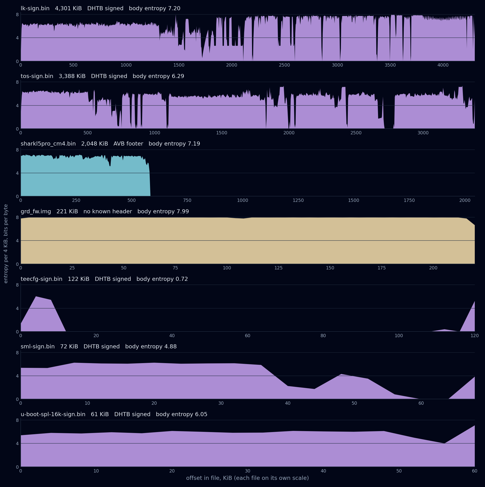
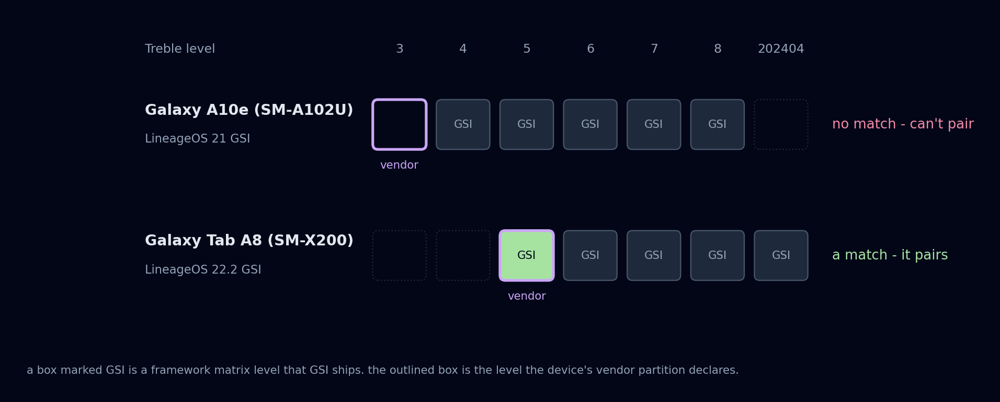

# Tab A8 teardown

**in progress.** the first pass is in - the things you can read straight off the stock firmware without a disassembler. sections still marked *not read yet* are just the questions, the same kind the [A10e teardown](https://github.com/CassieFox23/a10e-firmware/blob/master/A10e-teardown.md) answered for the phone.

everything here is static - files unpacked and read on a PC. nothing was run and nothing touched the tablet.

## the device

| | |
|---|---|
| model | SM-X200, device `gta8wifi`, product `gta8wifixx` |
| build read | `X200XXS6DYG6`, CSC `X200XAR6DYG6` (the XAR region) |
| Android | system is 14 (sdk 34), vendor is 11 (sdk 30), first API level 30 |
| security patch | 2025-08-01 on both |
| build type | `user`, `release-keys` |
| chip | Unisoc UMS512 - `ro.board.platform=ums512`, `ro.soc.model=T618`, `ro.soc.manufacturer=Spreadtrum` |

the model, versions and chip come from `build.prop` in the vendor and system partitions:

```
debugfs -R 'cat /build.prop' vendor.img
debugfs -R 'cat /system/build.prop' system.img
```

the device tree says the same. the `dtb` in `boot.img` has root model `Unisoc UMS512 SoC`, compatible `sprd,ums512` (900 nodes, 234 distinct `compatible` strings). `dtbo.img` carries five board overlays: `sprd,ums512-1h10`, `-1h10-go`, `-25c10`, `-2h10` and a second `-25c10`. the vendor's `ro.product.board=ums512_25c10` matches the 25c10 ones - which of the two the tablet picks isn't read.

```
python3 tools/dt_root.py boot/unpacked/dtb dtbo.img
```

### the bundles

the firmware comes as four `.tar.md5` bundles. each one's md5 line matches its contents (`tools/md5_check.py`) - that shows they're intact, not who made them.

| bundle | what's in it |
|---|---|
| BL | `u-boot-spl-16k-sign.bin`, `teecfg-sign.bin`, `sml-sign.bin`, `tos-sign.bin`, `lk-sign.bin`, `sharkl5pro_cm4.bin`, `grd_fw.img` |
| AP | `super.img`, `boot.img`, `dtbo.img`, `socko.img`, `recovery.img`, `gnssmodem.bin`, `EXEC_KERNEL_IMAGE.bin`, `userdata.img`, `AGCP_DSP.bin`, `vbmeta.img`, `vbmeta_system.img`, `meta-data/fota.zip` |
| CSC | `GTA8WIFI_EUR_OPEN.pit`, `cache.img`, `omr.img`, `optics.img`, `prism.img`, `meta-data/fota.zip` |
| HOME_CSC | `cache.img`, `prism.img`, `optics.img`, `meta-data/download-list.txt` |

```
python3 tools/md5_check.py *.tar.md5
tar -tvf BL_*.tar.md5        # same for AP, CSC, HOME_CSC
```

### the partition layout


the PIT has 58 entries, all on the eMMC, project name `COM_TAR2`, CPU/bootloader tag `SPRD8735`. the full table is in [`docs/partition-map.md`](docs/partition-map.md).

the PIT ties each BL file to a partition, which is the first real hint of what the bootloader pieces are:

| partition | file | size |
|---|---|---|
| `splloader` | `u-boot-spl-16k-sign.bin` | 0.5 MiB |
| `trustos` (+ `trustos_bak`) | `tos-sign.bin` | 6 MiB |
| `sml` (+ `sml_bak`) | `sml-sign.bin` | 1 MiB |
| `pm_sys` | `sharkl5pro_cm4.bin` | 2 MiB |
| `teecfg` (+ `teecfg_bak`) | `teecfg-sign.bin` | 1 MiB |
| `uboot` (+ `uboot_bak`) | `lk-sign.bin` | 5 MiB |
| `grd_fw` | `grd_fw.img` | 1 MiB |

those are names, not a read of the files. what each one does is still open.

the PIT also has `steady`, `persistent`, `param`, `vendor_efs` and `sec_efs` partitions, and a `vbmeta_vendor` one that no bundle ships an image for.

`super` is 6,740,246,528 bytes and holds four logical partitions in one group, `group_unisoc`: `system`, `system_ext`, `vendor`, `product`. there are no `_a` / `_b` copies.

```
simg2img super.img super.raw
lpdump super.raw
lpunpack -p vendor -p system super.raw .    # gives the vendor.img and system.img read below
```

## the boot chain

the BL bundle has seven files. this is a sizing pass over all of them - headers, hashes, signatures, entropy and strings. **nothing was disassembled.** it still settled more than expected, because the files check each other with plain hashes.


### the seven files

| file | goes to partition | size | container | what it is, by its strings |
|---|---|---|---|---|
| `u-boot-spl-16k-sign.bin` | `splloader` | 61 KiB | DHTB, signed | the first stage in the bundle. almost no readable text |
| `sml-sign.bin` | `sml` | 72 KiB | DHTB, signed | ARM Trusted Firmware's BL31, with hooks for Trusty (`NOTICE:  BL31: %s`, `trusty_fast`) |
| `tos-sign.bin` | `trustos` | 3,388 KiB | DHTB, signed | a Trusty image (`lk/trusty/...`, `com.android.trusty.keymaster.secure`) |
| `teecfg-sign.bin` | `teecfg` | 122 KiB | DHTB, signed | a config table, starts `TEE_CONFIG_HEADER`, mostly zeros |
| `lk-sign.bin` | `uboot` | 4,301 KiB | DHTB, signed | the bootloader proper - little kernel (`welcome to lk`), with `fastboot_handler`, `odin_handler`, the `OEM LOCK` and `KG STATE` screen text and the `androidboot.verifiedbootstate=` strings |
| `sharkl5pro_cm4.bin` | `pm_sys` | 2,048 KiB (579 KiB used) | AVB footer | firmware for a Cortex-M4 side processor (`SPRD-AP_FIRMWARE`, `SHUB:`) |
| `grd_fw.img` | `grd_fw` | 221 KiB | its own 256-byte header | two blocks that look random end to end. unknown |

the "what it is" column is names and strings only. a string in a file isn't proof the code behind it runs.

the numbers come from one script:

```
python3 tools/bl_sizing.py --vbmeta vbmeta.img --plot figures/bootloader-files.png \
    u-boot-spl-16k-sign.bin sml-sign.bin tos-sign.bin teecfg-sign.bin lk-sign.bin sharkl5pro_cm4.bin grd_fw.img
```

| file | body bytes | entropy | strings (8+) | AArch64 `ret` | hashes | signature |
|---|---|---|---|---|---|---|
| `u-boot-spl-16k-sign.bin` | 60704 | 6.05 | 66 | 202 | ok | ok |
| `sml-sign.bin` | 71920 | 4.88 | 121 | 339 | ok | ok |
| `tos-sign.bin` | 3467296 | 6.29 | 14028 | 1934 | ok | ok |
| `teecfg-sign.bin` | 122880 | 0.72 | 207 | 0 | ok | ok |
| `lk-sign.bin` | 4402800 | 7.20 | 8203 | 7913 | ok | ok |
| `sharkl5pro_cm4.bin` | 592784 | 7.19 | 1686 | 0 | - | - |
| `grd_fw.img` | 226560 | 7.99 | 57 | 0 | - | - |

"AArch64 `ret`" counts the 4-byte `ret` instruction at aligned offsets - a cheap way to tell ARM64 code from everything else.



### nothing readable is encrypted, except maybe one

the five signed files aren't encrypted. each body hashes to the SHA-256 stored in its own header, and four of the five are full of ARM64 code and plain strings. so the A10e's problem - an encrypted stage at the front of `sboot` - doesn't show up in these.

`grd_fw.img` is the odd one. it reads 7.99 bits per byte the whole way through, which is what compressed or encrypted data looks like, and it has no strings. what it's for isn't known.

### the DHTB container

the five `-sign.bin` files share a layout:

| offset | what |
|---|---|
| `0x000` | `DHTB`, then a version word (`1`) |
| `0x008` | SHA-256 of the body |
| `0x030` | body size |
| `0x200` | the body |
| after the body | a `SIMGHDR` block that gives the certificate's offset and size |
| after that | the certificate, 564 or 596 bytes |
| last 512 bytes | a `SignerVer02` block - the build (`X200XXS6DYG6`), a timestamp, the key name `SM-X200_EUR_XX_UKEY0`, and some binary that wasn't parsed |

the certificate:

| bytes | what |
|---|---|
| 4 | type, `0` or `1` |
| 4 + 4 + 256 | an RSA-2048 public key: bit count, exponent `65537`, modulus |
| 32 | SHA-256 of the body, again |
| 32, type `1` only | SHA-256 of the **next stage's key** |
| 8 | two words, `1` and `0x3f` in all five |
| 256 | the signature |

the signature is RSASSA-PSS (SHA-256, 32-byte salt) over the bytes from the body hash up to the signature, and all five verify against the key sitting in the same certificate. a certificate that checks out under its own key only shows the file is consistent - the trust has to come from the stage before it. that's what the type `1` field is for.

### the chain, from the hashes

- the SPL is signed with **key A** (`29f0d80a5959...`). its certificate is type `1` and carries `3ca58836d04d...`.
- `sml`, `tos`, `teecfg` and `lk` are all signed with **key B**, and SHA-256 over key B (bit count + exponent + modulus) is exactly `3ca58836d04d...`. so the SPL's certificate names the key the next four files must be signed with.
- `lk`'s certificate is also type `1`, and the hash it carries is `a406eeb5ebc0...` - the SHA-256 of the AVB public key in `vbmeta.img`. so the **signed bootloader names the one vbmeta key it goes with**.
- that AVB key then signs `vbmeta.img` and the chained partitions, as in the next section. the Cortex-M4 image is one of them: it has no DHTB wrapper, just an AVB footer for `pm_sys` signed by the same key.

so the question from the first pass - where does the bootloader keep the key it trusts - has a first answer without reading any code: the vbmeta key's hash rides in `lk`'s own signed certificate.

the full key ids are SHA-256 values: key A `29f0d80a5959c8513e45c56596d3ff31d21713352706e0e1844fc8d2a17dfc29`, key B `3ca58836d04d90a9acff83ae763a085ca6c50d2444784042aa731e7b0eeaeffd`, AVB key blob `a406eeb5ebc07a5cafabdb1bf2f4ad74275a533f67cc68e680345d22ddc66cef`.

*not read yet:*

- what trusts **key A**. nothing in these files names it, so it's below the SPL - most likely in the chip, but that's a guess until something shows it
- whether each stage really checks the next one this way at boot. the hashes line up, the code that uses them hasn't been read
- where the OEM-unlock state is stored and read
- what `lk` does differently once it's unlocked

### inside lk

`lk-sign.bin` is where the next read goes. its 4.2 MiB body splits three ways:

- ARM64 code up to about 1,314 KiB (the last `ret` is at body offset `0x148954`)
- tables and strings after that - binwalk finds CRC32 tables, an AES S-box and SHA-256 constants around 1.4 to 1.7 MiB
- JPEG pictures from 1,828 KiB on (74 JPEG start markers), which is why the file's entropy reads so high. what they show wasn't looked at

the strings say everything the A10e read went looking for is in here: `avb` (58 lines), `vbmeta` (70), `unlock` (37), `rpmb` (70), `efuse` (30), `odin` (59), `fastboot` (38), plus `Custom Binary Blocked By OEM Lock` and `[KG] failed to malloc kg state block`. so this bootloader has Knox Guard text in it too - whether a path behind it runs on this tablet is for the read.

its load address isn't in the DHTB header, so that still has to be worked out before any reference can be trusted - the same job that went wrong first time on the A10e.

one thing the firmware does say: the vendor's `default.prop` has `ro.oem_unlock_supported=1`. the A10e had that same line and still wouldn't unlock, so on its own it settles nothing.

what settles it is the tablet: it does unlock. the OEM unlocking switch is there, a long press in Download Mode does the unlock and the wipe, and `ro.boot.flash.locked` reads `0` afterwards. the steps are in the [how-to](docs/lineageos-howto.md). before the unlock, the Download Mode screen read `OEM LOCK` on and `KG STATE` completed.

## verified boot


what `vbmeta.img` says, read with `avbtool info_image --image vbmeta.img`:

- signed `SHA256_RSA4096`, public key sha1 `3ddc850a07d1098ad2613023f0c226488c357af9`
- flags `0`, rollback index `0`
- eight **chained** partitions, all naming that same key: `dtbo`, `boot`, `recovery`, `pm_sys`, `l_agdsp`, `prism`, `optics`, `socko`. a chained partition carries its own vbmeta footer - `boot.img` was the one checked, and `avbtool info_image --image boot.img` shows a footer with a sha256 hash descriptor for `boot`, signed by that key
- three **hashtree** partitions, checked block by block with dm-verity (sha256): `system`, `vendor`, `product`
- version props: boot and vendor `11`, system `14`, all patch `2025-08-01`

`vbmeta_system.img` is signed with the same key and carries the same three hashtrees again (`system`, `vendor`, `product`). the main vbmeta has no chain entry pointing at it.

that key isn't the A10e's (`e553992a79ab561a4805371cce123d1ee73db21b`).

one thing seen on the real tablets, from the flash logs in the [how-to](docs/lineageos-howto.md): with the bootloader unlocked, a `system` image that isn't Samsung's booted, and no command in the logs ever wrote to `vbmeta` or turned verification off. after the unlock the tablet reported `ro.boot.verifiedbootstate` as `orange`. so once it's unlocked, the hashtree for `system` in vbmeta didn't stop a different system from starting. that's what happened, not a read of the code that decides it - and the `vbmeta` partition wasn't read back off the tablet to prove it's still the stock one.

the hash of this key is carried in the bootloader's own signed certificate - see [the chain, from the hashes](#the-chain-from-the-hashes).

*not read yet:*

- what the bootloader does with an image signed by another key while **locked**
- the code path behind the unlocked behaviour above

## why a GSI fits

this is the wall the A10e hit second, and the tablet doesn't have it.



the rule, from Android's [VINTF match rules](https://source.android.com/docs/core/architecture/vintf/match-rules): a system image is paired with the vendor code using the framework matrix whose level equals the vendor's `target-level`.

| | A10e | Tab A8 |
|---|---|---|
| vendor `target-level` | 3 | **5** |
| vendor wants VNDK | 28 | **30** |
| kernel | 4.4.111 | **4.14.199** |

the A10e's numbers are from its teardown. the tablet's come from the vendor partition:

```
debugfs -R 'cat /etc/vintf/manifest.xml' vendor.img              # <manifest ... target-level="5">, <kernel target-level="5"/>
debugfs -R 'cat /etc/vintf/compatibility_matrix.xml' vendor.img  # <vendor-ndk><version>30
debugfs -R 'cat /build.prop' vendor.img                          # ro.vndk.version=30
```

and the GSI was checked the same way - `LineageOS-22.2-20260105-VANILLA-EXT4-GSI.img`, Android 15 (sdk 35):

- `/system/etc/vintf/` has framework matrices for levels 5, 6, 7, 8 and 202404 - so there **is** a level 5 one
- that level 5 matrix takes a 4.14 kernel from `4.14.180` up, and the tablet's is `4.14.199`
- `/system/system_ext/apex/` has `com.android.vndk.v30.apex`, the VNDK the vendor asks for

```
debugfs -R 'ls -l /system/etc/vintf' GSI.img
debugfs -R 'cat /system/etc/vintf/compatibility_matrix.5.xml' GSI.img | grep -o '<kernel version="[^"]*" level="5">' | sort | uniq -c
debugfs -R 'ls -l /system/system_ext/apex' GSI.img
```

so all three line up. this is a read of the files, not a run of Android's own `checkvintf` tool, and the per-HAL rows inside the matrix weren't compared one by one.

Samsung's own stock system (Android 14) ships matrices for levels 4 to 8, so it leans on the same level 5 match - an Android 11 vendor under a newer system is how this tablet ships.

## the secure world

*not read yet.* one early pointer from the bootloader files: `tos-sign.bin` is a Trusty image by its strings, and `sml-sign.bin` is ARM Trusted Firmware with Trusty hooks. the A10e ran Samsung's TEEGRIS. `lk` has no `teegris` string at all and 49 lines with `trusty`.

- which TEE this chip runs and what talks to it
- what the SELinux policy lets a normal app reach

## the kernel

`boot.img` is a header v2 image: os version `11.0.0`, patch level `2025-08`, 2048-byte pages, cmdline `console=ttyS1,115200n8`. the kernel inside is a raw ARM64 `Image` and says:

```
Linux version 4.14.199-29056031-abX200XXS6DYG6 ... clang version 11.0.1 ... #2 SMP PREEMPT Mon Jul 28 15:32:23 KST 2025
```

```
unpack_bootimg --boot_img boot.img --out boot/unpacked
strings -n 8 boot/unpacked/kernel | grep -m1 '^Linux version'
```

Samsung's published source for this build is the same `4.14.199` (its `Makefile`: `VERSION = 4`, `PATCHLEVEL = 14`, `SUBLEVEL = 199`) and has a `gta8wifi_eur_open_defconfig`. the `-29056031-abX200XXS6DYG6` part of the version isn't in that defconfig (`CONFIG_LOCALVERSION=""`). where it comes from isn't traced.

*not read yet:* whether that source builds into this exact kernel.

## what didn't work, and mistakes

kept on purpose, same as the A10e one.

- **the md5 check that failed for the wrong reason.** the first try at checking the bundles cut the md5 line off at the last newline before it, and the BL and AP bundles came out as mismatches. the last bytes show why (`tail -c 176 <bundle> | xxd`): in the CSC bundle the hash follows a text line ending in a newline (`original_tar_file_size:67543040`), so that cut works. in the BL bundle zero bytes run right up to the hash with no newline, so the cut lands somewhere earlier. cutting at the hash itself fixed it, and all four match. the AP bundle's tail wasn't looked at, it just passes the same fix. `tools/md5_check.py` does it the right way.
