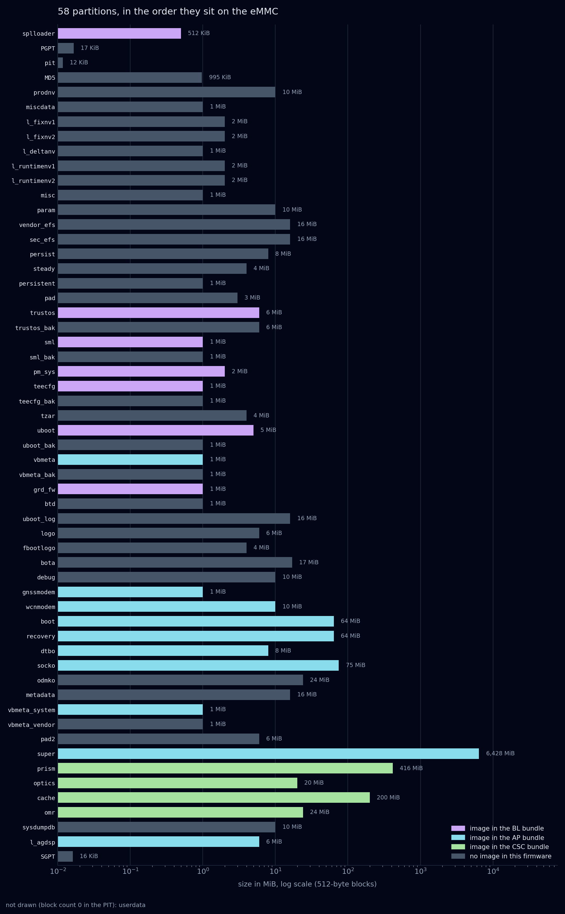
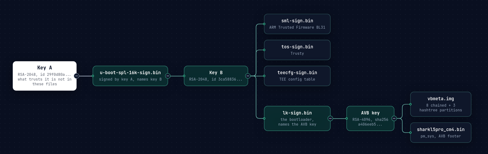

# Tab A8 teardown

**in progress.** the first pass is in - the things you can read straight off the stock firmware without a disassembler - and so is a first read of the bootloader's first two stages with one. sections still marked *not read yet* are just the questions, the same kind the [A10e teardown](https://github.com/CassieFox23/a10e-firmware/blob/master/A10e-teardown.md) answered for the phone.

the read is static - files unpacked and read on a PC, with none of the firmware's code run. where something was seen on the real tablets it says so, and it comes from the flash logs behind the [how-to](docs/lineageos-howto.md).

## the device

| | |
|---|---|
| model | SM-X200, device `gta8wifi`, product `gta8wifixx` |
| build read | `X200XXS6DYG6`, CSC `X200XAR6DYG6` (the XAR region) |
| Android | system is 14 (sdk 34), vendor is 11 (sdk 30), first API level 30 |
| security patch | 2025-08-01 on both |
| build type | `user`, `release-keys` |
| chip | Unisoc UMS512 - `ro.board.platform=ums512`, `ro.soc.model=T618`, `ro.soc.manufacturer=Spreadtrum` |

the model, versions and chip come from `build.prop` in the vendor and system partitions:

```
debugfs -R 'cat /build.prop' vendor.img
debugfs -R 'cat /system/build.prop' system.img
```

the device tree says the same. the `dtb` in `boot.img` has root model `Unisoc UMS512 SoC`, compatible `sprd,ums512` (900 nodes, 234 distinct `compatible` strings). `dtbo.img` carries five board overlays: `sprd,ums512-1h10`, `-1h10-go`, `-25c10`, `-2h10` and a second `-25c10`. the vendor's `ro.product.board=ums512_25c10` matches the 25c10 ones - which of the two the tablet picks isn't read.

```
python3 tools/dt_root.py boot/unpacked/dtb dtbo.img
```

### the bundles

the firmware comes as four `.tar.md5` bundles. each one's md5 line matches its contents (`tools/md5_check.py`) - that shows they're intact, not who made them.

| bundle | what's in it |
|---|---|
| BL | `u-boot-spl-16k-sign.bin`, `teecfg-sign.bin`, `sml-sign.bin`, `tos-sign.bin`, `lk-sign.bin`, `sharkl5pro_cm4.bin`, `grd_fw.img` |
| AP | `super.img`, `boot.img`, `dtbo.img`, `socko.img`, `recovery.img`, `gnssmodem.bin`, `EXEC_KERNEL_IMAGE.bin`, `userdata.img`, `AGCP_DSP.bin`, `vbmeta.img`, `vbmeta_system.img`, `meta-data/fota.zip` |
| CSC | `GTA8WIFI_EUR_OPEN.pit`, `cache.img`, `omr.img`, `optics.img`, `prism.img`, `meta-data/fota.zip` |
| HOME_CSC | `cache.img`, `prism.img`, `optics.img`, `meta-data/download-list.txt` |

```
python3 tools/md5_check.py *.tar.md5
tar -tvf BL_*.tar.md5        # same for AP, CSC, HOME_CSC
```

### the partition layout



the PIT has 58 entries, all on the eMMC, project name `COM_TAR2`, CPU/bootloader tag `SPRD8735`. the full table is in [`docs/partition-map.md`](docs/partition-map.md).

the PIT ties each BL file to a partition, which is the first real hint of what the bootloader pieces are:

| partition | file | size |
|---|---|---|
| `splloader` | `u-boot-spl-16k-sign.bin` | 0.5 MiB |
| `trustos` (+ `trustos_bak`) | `tos-sign.bin` | 6 MiB |
| `sml` (+ `sml_bak`) | `sml-sign.bin` | 1 MiB |
| `pm_sys` | `sharkl5pro_cm4.bin` | 2 MiB |
| `teecfg` (+ `teecfg_bak`) | `teecfg-sign.bin` | 1 MiB |
| `uboot` (+ `uboot_bak`) | `lk-sign.bin` | 5 MiB |
| `grd_fw` | `grd_fw.img` | 1 MiB |

those are names, not a read of the files. what each one does is still open.

the PIT also has `steady`, `persistent`, `param`, `vendor_efs` and `sec_efs` partitions, and a `vbmeta_vendor` one that no bundle ships an image for.

`super` is 6,740,246,528 bytes and holds four logical partitions in one group, `group_unisoc`: `system`, `system_ext`, `vendor`, `product`. there are no `_a` / `_b` copies.

```
simg2img super.img super.raw
lpdump super.raw
lpunpack -p vendor -p system super.raw .    # gives the vendor.img and system.img read below
```

## the boot chain

the BL bundle has seven files. first comes a sizing pass over all of them - headers, hashes, signatures, entropy and strings, with nothing disassembled. it settled more than expected, because the files check each other with plain hashes. the read of the code in `lk` and the SPL starts at [pinning the load addresses](#pinning-the-load-addresses).



### the seven files

| file | goes to partition | size | container | what it is, by its strings |
|---|---|---|---|---|
| `u-boot-spl-16k-sign.bin` | `splloader` | 61 KiB | DHTB, signed | the first stage in the bundle. almost no readable text |
| `sml-sign.bin` | `sml` | 72 KiB | DHTB, signed | ARM Trusted Firmware's BL31, with hooks for Trusty (`NOTICE:  BL31: %s`, `trusty_fast`) |
| `tos-sign.bin` | `trustos` | 3,388 KiB | DHTB, signed | a Trusty image (`lk/trusty/...`, `com.android.trusty.keymaster.secure`) |
| `teecfg-sign.bin` | `teecfg` | 122 KiB | DHTB, signed | a config table, starts `TEE_CONFIG_HEADER`, mostly zeros |
| `lk-sign.bin` | `uboot` | 4,301 KiB | DHTB, signed | the bootloader proper - little kernel (`welcome to lk`), with `fastboot_handler`, `odin_handler`, the `OEM LOCK` and `KG STATE` screen text and the `androidboot.verifiedbootstate=` strings |
| `sharkl5pro_cm4.bin` | `pm_sys` | 2,048 KiB (579 KiB used) | AVB footer | firmware for a Cortex-M4 side processor (`SPRD-AP_FIRMWARE`, `SHUB:`) |
| `grd_fw.img` | `grd_fw` | 221 KiB | its own 256-byte header | two blocks that look random end to end. unknown |

the "what it is" column is names and strings only. a string in a file isn't proof the code behind it runs.

the numbers come from one script:

```
python3 tools/bl_sizing.py --vbmeta vbmeta.img --plot figures/bootloader-files.png \
    u-boot-spl-16k-sign.bin sml-sign.bin tos-sign.bin teecfg-sign.bin lk-sign.bin sharkl5pro_cm4.bin grd_fw.img
```

| file | body bytes | entropy | strings (8+) | AArch64 `ret` | hashes | signature |
|---|---|---|---|---|---|---|
| `u-boot-spl-16k-sign.bin` | 60704 | 6.05 | 66 | 202 | ok | ok |
| `sml-sign.bin` | 71920 | 4.88 | 121 | 339 | ok | ok |
| `tos-sign.bin` | 3467296 | 6.29 | 14028 | 1934 | ok | ok |
| `teecfg-sign.bin` | 122880 | 0.72 | 207 | 0 | ok | ok |
| `lk-sign.bin` | 4402800 | 7.20 | 8203 | 7913 | ok | ok |
| `sharkl5pro_cm4.bin` | 592784 | 7.19 | 1686 | 0 | - | - |
| `grd_fw.img` | 226560 | 7.99 | 57 | 0 | - | - |

"AArch64 `ret`" counts the 4-byte `ret` instruction at aligned offsets - a cheap way to tell ARM64 code from everything else.


### nothing readable is encrypted, except maybe one

the five signed files aren't encrypted. each body hashes to the SHA-256 stored in its own header, and four of the five are full of ARM64 code and plain strings. so the A10e's problem - an encrypted stage at the front of `sboot` - doesn't show up in these.

`grd_fw.img` is the odd one. it reads 7.99 bits per byte the whole way through, which is what compressed or encrypted data looks like, and it has no strings. what it's for isn't known.

### the DHTB container

the five `-sign.bin` files share a layout:

| offset | what |
|---|---|
| `0x000` | `DHTB`, then a version word (`1`) |
| `0x008` | SHA-256 of the body |
| `0x030` | body size |
| `0x200` | the body |
| after the body | a `SIMGHDR` block that gives the certificate's offset and size |
| after that | the certificate, 564 or 596 bytes |
| last 512 bytes | a `SignerVer02` block - the build (`X200XXS6DYG6`), a timestamp, the key name `SM-X200_EUR_XX_UKEY0`, and some binary that wasn't parsed |

the certificate:

| bytes | what |
|---|---|
| 4 | type, `0` or `1` |
| 4 + 4 + 256 | an RSA-2048 public key: bit count, exponent `65537`, modulus |
| 32 | SHA-256 of the body, again |
| 32, type `1` only | SHA-256 of the **next stage's key** |
| 8 | two words, `1` and `0x3f` in all five |
| 256 | the signature |

the signature is RSASSA-PSS (SHA-256, 32-byte salt) over the bytes from the body hash up to the signature, and all five verify against the key sitting in the same certificate. a certificate that checks out under its own key only shows the file is consistent - the trust has to come from the stage before it. that's what the type `1` field is for.

### the chain, from the hashes

- the SPL is signed with **key A** (`29f0d80a5959...`). its certificate is type `1` and carries `3ca58836d04d...`.
- `sml`, `tos`, `teecfg` and `lk` are all signed with **key B**, and SHA-256 over key B (bit count + exponent + modulus) is exactly `3ca58836d04d...`. so the SPL's certificate names the key the next four files must be signed with.
- `lk`'s certificate is also type `1`, and the hash it carries is `a406eeb5ebc0...` - the SHA-256 of the AVB public key in `vbmeta.img`. so the **signed bootloader names the one vbmeta key it goes with**.
- that AVB key then signs `vbmeta.img` and the chained partitions, as in the next section. the Cortex-M4 image is one of them: it has no DHTB wrapper, just an AVB footer for `pm_sys` signed by the same key.

so the question from the first pass - where does the bootloader keep the key it trusts - has a first answer without reading any code: the vbmeta key's hash rides in `lk`'s own signed certificate.

the full key ids are SHA-256 values: key A `29f0d80a5959c8513e45c56596d3ff31d21713352706e0e1844fc8d2a17dfc29`, key B `3ca58836d04d90a9acff83ae763a085ca6c50d2444784042aa731e7b0eeaeffd`, AVB key blob `a406eeb5ebc07a5cafabdb1bf2f4ad74275a533f67cc68e680345d22ddc66cef`.

*not read yet:*

- what trusts **key A**. nothing in these files names it, so it's below the SPL - most likely in the chip, but that's a guess until something shows it
- the hashing and signature routines themselves, in any stage

### inside lk

`lk-sign.bin` is where the next read goes. its 4.2 MiB body splits three ways:

- ARM64 code up to about 1,314 KiB (the last `ret` is at body offset `0x148954`)
- tables and strings after that - binwalk finds CRC32 tables, an AES S-box and SHA-256 constants around 1.4 to 1.7 MiB
- JPEG pictures from 1,828 KiB on (74 JPEG start markers), which is why the file's entropy reads so high. what they show wasn't looked at

the strings say everything the A10e read went looking for is in here: `avb` (58 lines), `vbmeta` (70), `unlock` (37), `rpmb` (70), `efuse` (30), `odin` (59), `fastboot` (38), plus `Custom Binary Blocked By OEM Lock` and `[KG] failed to malloc kg state block`. so this bootloader has Knox Guard text in it too - whether a path behind it runs on this tablet is for the read.

its load address isn't in the DHTB header, so that had to be worked out before any reference could be trusted - the same job that went wrong first time on the A10e.

### who checks whom


that's the read below in one picture. green is bootloader code that was read, red is the secure world, which wasn't.

### pinning the load addresses

both files are raw code with no load address in the header, so that came first. `tools/pin_base.py` finds it two ways that don't depend on each other:

| file | absolute pointers that land on a string | ADRP page phase | load address |
|---|---|---|---|
| `lk` body | 1856 at `0x9f000000`, runner-up 997 | `0x000` (4812 hits, next best 1719) | **`0x9f000000`** |
| SPL body | 11 at `0x5700`, runner-up 6 | `0x700` (29 hits, next best 11) | **`0x5700`** |

the SPL's is thin on its own - it only has 83 strings by this script's count (6 characters or more, ending in a zero byte - the sizing table's 66 counts 8 or more) - but the two methods agree, and the SPL's own code settles `lk`'s: it loads the `uboot` partition to `0x9f000000` with the 512-byte header just below at `0x9efffe00`.

the SPL's phase is `0x700`, not `0`. that's the same trap as the A10e, where assuming phase 0 quietly pointed every reference at the wrong string.

```
python3 tools/pin_base.py lk.body
python3 tools/pin_base.py spl.body
python3 tools/a64_refs.py lk.body 0x9f000000 "is_oem_unlock_possible" "flashed due to KG locked."
```

everything below is Ghidra's decompiler output (through [REA](https://github.com/morluto/rea)) for a handful of functions, named by address. it's a read of the paths that answer the open questions, not of the whole bootloader.

### what the SPL does

one function, at `0xf898`, does the loading:

1. loads `teecfg` to `0x94040000`
2. reads `tee_sml_addr` and `tee_tos_addr` out of it (the variables start at `0x94000000` and `0x94060000`)
3. loads `sml`, `trustos` and `uboot` - the last one to `0x9f000000`
4. checks each with the function at `0x10c24`. if a check fails it loads the `_bak` partition and checks that. if that fails too it sits in an endless loop
5. jumps to `sml`, handing it the `trustos` and `teecfg` addresses. in one mode it skips the TEE files and jumps straight to `lk` - what picks that mode wasn't read

the check is the chain from the hashes, in code:

- `0x10c24` is called as `(0x5500, header of the next image)`. `0x5500` is the SPL's **own** header, 512 bytes below where it runs. it pulls 32 bytes out of its own image (`0x10bd8`)
- `0x10b78` then takes the next image's body size from header offset `0x30`, hashes the body (`0x107b4`), and passes the hash, those 32 bytes and the next image's certificate to `0x10940`

so the SPL carries the expected key hash in its own signed image and checks the next stage against it - what the certificates said, now seen in the code that uses them.

*not read:* the insides of `0x10bd8`, `0x107b4` and `0x10940`. the SPL body has no SHA-256 constants in it, so where the hashing actually runs isn't known. and the SPL is the thing being checked at the very start, not the checker, so it doesn't say what trusts key A.

### what lk does about locking

**the unlock state is a record in `miscdata`, and the secure world judges it.**

- one global, at `0x9f4388a8`, holds "unlocked". exactly one function writes it: `0x9f121324`
- that function reads 512 bytes from the `miscdata` partition at offset `0x2000` and hands the first 64 to `0x9f0108e8`
- `0x9f0108e8` copies them into a page-aligned buffer and sends **command `0x33`** to the secure world. it counts as unlocked only if the call returns `0` and a byte in the reply is set
- so `lk` doesn't decide by itself whether the tablet is unlocked. it asks the secure world and keeps the answer in that global. how often `0x9f121324` runs wasn't read

the call itself: 27 small wrappers each load a command number (`0x1` to `0x50`) and call a dispatcher at `0x9f14325c`, which calls `0x9f147000`, where the `smc` instruction is (`0x9f147018`).

"the secure world" in this section means whatever answers that `smc`. the read of `lk` stops at the instruction - what sits on the other side belongs to [the secure world](#the-secure-world).

that global then drives the kernel command line: `0x9f007b2c` appends `androidboot.flash.locked=0` when it's `1`, and `=1` otherwise.

**the "OEM unlocking" switch is one byte.** `0x9f0351d0` reads the last 512 bytes of the `persistent` partition and returns whether the very last byte is non-zero. that's the switch in Developer options.

**whether an unlock is allowed** is `0x9f03536c`, and it logs its answer as `is_oem_unlock_possible`:

1. already unlocked - yes
2. the switch byte is zero - no
3. otherwise it depends on Knox Guard (`0x9f0352cc`): **no** if the KG state is `PRENORMAL`, `ACTIVE`, `LOCKED` or `ERROR`, or if one more check (`0x9f038880`, not read) returns `0x20`

the KG state names come from a table at `0x9f1c0b10`:

| value | state |
|---|---|
| 0 | `PRENORMAL` |
| 1 | `CHECKING` |
| 2 | `ACTIVE` |
| 3 | `LOCKED` |
| 4 | `COMPLETED` |
| 5 | `ERROR` |
| 6 | `BROKEN` |
| 7 | `ALLZERO` |

this fits what the real tablets did: their Download Mode screen read `KG STATE` completed, and they unlocked.

**Knox Guard also gates flashing.** in the flash handler at `0x9f017010`, the code just before the message `All binaries are not allowed to be flashed due to KG locked.` is: KG state equals `3` (`LOCKED`), and a second function (`0x9f037540`, not read) returns `0`. this one is from decoding the branches, not from the decompiler. the same message is used a second time, at `0x9f01845c` in a function starting `0x9f0179a0`, which wasn't read.

**the Download Mode screen** is printed by `0x9f0364fc`: `ODIN MODE`, `PRODUCT NAME`, `CURRENT BINARY` (Samsung Official or Custom), `FRP LOCK`, `OEM LOCK`, `KG STATUS`, `UNISOC SECURE BOOT`, `WARRANTY VOID`, `RP SWREV`, `SECURE DOWNLOAD` and `GRDM STATUS`. its `OEM LOCK` line comes from the same `miscdata` check and the same switch byte.

### what lk does about verified boot

the boot flow runs through `0x9f010c48` (it logs `SECUREBOOT_ENABLE`): it picks `boot` or `recovery`, calls `0x9f120b00` on that name, then `0x9f121540`, sets the root of trust, and later checks `pm_sys` under a flag. those two calls are the two halves of verified boot - the secure-world check first, then `lk`'s own libavb.

**the boot-state decision: `0x9f120b00`.** given a partition name it:

1. loads the partition (`boot`/`recovery` to `0xb0000000`; the `vbmeta_*` names at size `0x1000`) and fills a request struct at `*0x9f9ab090`
2. if the name is `boot` or `recovery` **and the tablet is unlocked** (`0x9f4388a8 == 1`), it logs `Device Status is unlock, skip %s image verify!` and **doesn't call the secure world at all**
3. otherwise it sends the image to the secure world with **command `0x20`** (wrapper `0x9f142de4`, struct size `0x68`). if the wrapper's return doesn't match the code in the reply, it logs `tos return error!` and **sits in an endless loop**
4. then it sets the boot-state global `0x9f435010` from the result: unlocked → `2`; result `0` → `0` (unless the state is already `3`); result `5` → `1`; anything else → `3`

so the state the tablet boots with is set by the **secure-world** check, and on an unlocked `boot`/`recovery` that check is skipped and the state is `2`. that's the orange the real tablets showed - a non-Samsung system booted and the state went orange. the four values (`0`, `1`, `2`, `3`) line up with the four strings `green`/`yellow`/`orange`/`red`, but which number is which wasn't read; `tools/a64_refs.py` puts the code using `yellow` and `red` (`0x9f007b00`, `0x9f007b0c`) in a function at `0x9f007a3c`, just ahead of the `flash.locked` code at `0x9f007b2c`.

there's a near-twin, `0x9f1206d0`, with the same shape (footer, load vbmeta, command `0x20`, set `0x9f435010`) but a slightly different mapping (its locked-`5` goes to `3`, not `1`). nothing was found calling it - no `bl`/`b`, no `ADRP`+`ADD`, not stored as data - so it reads like a dead or alternate copy, and the live numbers above are `0x9f120b00`'s.

**`lk` also checks vbmeta itself, after that.** `0x9f121540` always runs. first, only when the tablet is **not** unlocked and the name isn't `recovery` (and only once - a flag at `0x9f9ac025` remembers), it calls `0x9f120b00("vbmeta_system")` and logs that `vbmeta_vendor`, `odmko` and `socko` are skipped. then, locked or not, it calls `0x9f11f9a0` - `lk`'s own libavb:

- `0x9f11f9a0` → `0x9f124e64` (`avb check image name`) → `avb_slot_verify` (`0x9f129684`) → `load_and_verify_vbmeta` (`0x9f1281e0`) → `avb_vbmeta_image_verify` (`0x9f12a868`)
- `0x9f12a868` calls SHA-256 and SHA-512 routines and an RSA check at `0x9f126f18` (`Signature length does not match key length.`), so vbmeta's hash and signature are checked by `lk`'s own code
- whether that key is one to trust is asked through a function pointer - slot `+0x30` of a table at `0x9f9ae060`. the table sits past the end of the file, filled in while `lk` runs, so what's behind the slot wasn't read
- `0x9f124e64` turns on "allow verification errors" when a flag at `0x9f9af000` is `0` and the unlock check (`0x9f121324`) says unlocked, logging `avb allow verification error in UNLOCK status while normal booting`
- but `0x9f11f9a0` only logs `avb_check_image`'s return and builds the kernel cmdline from it; in what Ghidra shows that return isn't acted on (it flags a terminal call at `0x9f11fac8`, so the tail may be cut). so `lk`'s libavb feeds the kernel command line, while the **boot-state gate is the secure-world `0x20` check above**. the state global is stored to in three functions only, all of them `0x20` callers: `0x9f120b00`, `0x9f1208b0` and the uncalled `0x9f1206d0`

the libavb names are its own, from each function's log strings. Ghidra starts two of them four bytes earlier than `tools/a64_refs.py` does (`0x9f1281e0`/`0x9f11f9a0` vs `0x9f1281e4`/`0x9f11f9a4`).

**command `0x20` has four callers.** two are on the boot path read here: `0x9f120b00`, and `0x9f1208b0`, which `0x9f010c48` calls on `pm_sys` (the Cortex-M4 image) under a flag - that one wasn't read through. `0x9f120b00` has a third call site besides the two above, at `0x9f00efe4`, not read. the other two callers are `0x9f123d88` (`check vbmeta image.`, by its string only) and the uncalled twin `0x9f1206d0`.

`0x9f010c48` itself is reached by 18 plain branches from one stretch of code (`0x9f011eb4` to `0x9f01254c`), which wasn't read.

```
python3 tools/a64_refs.py lk.body 0x9f000000 "SECUREBOOT_ENABLE" "Device Status is unlock, skip" \
    "avb check image name" "Signature length does not match key length." "check vbmeta image."
```

**what reads the boot state.** three functions load `0x9f435010`:

- **`0x9f01098c` acts on it.** `0x9f010c48` calls it right after `0x9f121540`, and it's a switch on the state:

  | state | what it does |
  |---|---|
  | `0` | logs `WARNNING: OEM KEY VERIFY SUCCESS!!!` and returns |
  | `1` | logs `WARNNING: USER KEY VERIFY SUCCESS!!!` and returns |
  | `2` | calls `0x9f057548`, then polls `0x9f002680` every 10 ticks for up to 10000, then `0x9f05741c`. the unlocked path, so most likely the warning the tablets show at startup - the three calls weren't read |
  | `3` | prints `TO be implement Reason` to the screen, calls `0x9f0121a8` - which goes into **Download Mode** - and only if that comes back logs `WARNNING: Oem Key & User Key Verify Failed!!!`, waits 60 x 100 ticks and returns |
  | other | logs `WARNNING: VERIFY RESULT UNKNOWN!!!` |

  so going by its own log lines the numbers are `0` Samsung's key, `1` a user key, `2` unlocked, `3` failed - which fits green, yellow, orange, red, though the code that picks the colour string still wasn't read.

  **so a locked tablet that fails the check lands in Download Mode.** `0x9f0121a8` logs `enter fastboot_mode`, sets the mode name to `fastboot`, logs `enter odin mode` and jumps to `0x9f018748`. that one logs `start Odin Mode...`, draws the download logo and the Download Mode screen (`0x9f0364fc`, the same one as above), brings USB up and then loops on the Odin handler with no way out of the loop. there's one check before the loop that would let it return - a setup call, `0x9f0164fc` - but that call can't fail: it sets the download buffer to `0x82000000`, 256 MiB long, logs it and returns `0`. so in the code as read, the tablet stays in Download Mode
- **`0x9f0349a0` is Samsung's own tally** (`check_secure_boot` in its log lines). it goes through `vbmeta` and then `boot`, `l_agdsp`, `uboot`, `trustos` and `super` (or just `recovery`), and marks each `SAMSUNG` or `CUSTOM`. it only looks at the boot state to skip some of the marking when the state is `3`. this is where the official-or-custom binary status comes from, not a gate
- **`0x9f112fe4` copies it out** (`populate rot info for grdm`): the state, whether the tablet is locked, a hash taken from `lk`'s own header at `0x9efffe00`, and the OS version and patch levels, into one record. what `grdm` is wasn't read

an earlier pass of this page listed a fourth reader, `0x9f014508`. that was wrong: it reads offset `0x10` of the boot image header, which sits in the same memory page at `0x9f435aa0`.

```
python3 tools/a64_refs.py lk.body 0x9f000000 "WARNNING: OEM KEY" "WARNNING: USER KEY" "start Odin Mode"   # reports the function as 0x9f010990, Ghidra as 0x9f01098c
```

the other two were found by scanning for loads of `0x9f435010` and then decompiled; their log strings are built in ways `a64_refs.py` doesn't follow.

*not read:*

- the code that turns the state number into the colour string
- what Trusty does with commands `0x20` and `0x33` - that's the secure world's side, [below](#the-secure-world)
- what sits behind `lk`'s "is this key trusted" slot (`0x9f9ae060` + `0x30`)
- who writes the `miscdata` record when you unlock, and what's in its 64 bytes
- the second flash-gate helper `0x9f038880` (the first, `0x9f037540`, is a bitmask test of a flags global at `0x9f45b290` - not a secure-world call)
- the warranty bit

### against the A10e's sboot

| | A10e `sboot` | Tab A8 |
|---|---|---|
| shape | one 4 MiB image with an encrypted stage at the front | separate files per stage, none of the signed ones encrypted |
| finding the load address | one address, and the page phase was the trap | two addresses, same trap in the SPL (phase `0x700`) |
| who checks the vbmeta key | the bootloader itself, calling libavb | both, and the secure world's answer sets the boot state: `lk` hands the image to the secure world (command `0x20`) and the state comes from that; its own libavb runs too, checking the signature and building the cmdline |
| who holds the unlock state | read inside the bootloader | a record in `miscdata` that the secure world judges |
| Knox Guard | gates flashing in Download Mode | gates flashing, and gates unlocking too |
| can it unlock | no, on that unit | yes |

the A10e column is from its [teardown](https://github.com/CassieFox23/a10e-firmware/blob/master/A10e-teardown.md).

the big difference is where the decisions sit. on the A10e they're in the bootloader you can read. here the bootloader asks the secure world about both: the unlock state, and the vbmeta check whose answer sets the boot state. `lk` runs its own libavb too, but that feeds the kernel cmdline - the orange/green/red gate and the root of trust both come from the secure-world check. what's behind the `smc` belongs to [the secure world](#the-secure-world).

one thing the firmware does say: the vendor's `default.prop` has `ro.oem_unlock_supported=1`. the A10e had that same line and still wouldn't unlock, so on its own it settles nothing.

what settles it is the tablet: it does unlock. the OEM unlocking switch is there, a long press in Download Mode does the unlock and the wipe, and `ro.boot.flash.locked` reads `0` afterwards. the steps are in the [how-to](docs/lineageos-howto.md). before the unlock, the Download Mode screen read `OEM LOCK` on and `KG STATE` completed.

## verified boot


what `vbmeta.img` says, read with `avbtool info_image --image vbmeta.img`:

- signed `SHA256_RSA4096`, public key sha1 `3ddc850a07d1098ad2613023f0c226488c357af9`
- flags `0`, rollback index `0`
- eight **chained** partitions, all naming that same key: `dtbo`, `boot`, `recovery`, `pm_sys`, `l_agdsp`, `prism`, `optics`, `socko`. a chained partition carries its own vbmeta footer - `boot.img` was the one checked, and `avbtool info_image --image boot.img` shows a footer with a sha256 hash descriptor for `boot`, signed by that key
- three **hashtree** partitions, checked block by block with dm-verity (sha256): `system`, `vendor`, `product`
- version props: boot and vendor `11`, system `14`, all patch `2025-08-01`

`vbmeta_system.img` is signed with the same key and carries the same three hashtrees again (`system`, `vendor`, `product`). the main vbmeta has no chain entry pointing at it.

that key isn't the A10e's (`e553992a79ab561a4805371cce123d1ee73db21b`).

one thing seen on the real tablets, from the flash logs in the [how-to](docs/lineageos-howto.md): with the bootloader unlocked, a `system` image that isn't Samsung's booted, and no command in the logs ever wrote to `vbmeta` or turned verification off. after the unlock the tablet reported `ro.boot.verifiedbootstate` as `orange`. so once it's unlocked, the hashtree for `system` in vbmeta didn't stop a different system from starting. that's what happened, not a read of the code that decides it - and the `vbmeta` partition wasn't read back off the tablet to prove it's still the stock one.

the hash of this key is carried in the bootloader's own signed certificate - see [the chain, from the hashes](#the-chain-from-the-hashes).

the code behind that is in [what lk does about verified boot](#what-lk-does-about-verified-boot): when the tablet is unlocked, the boot state is set without looking at the check's result.

and a failed check while **locked** ends in Download Mode - the same section has the read.

## why a GSI fits

this is the wall the A10e hit second, and the tablet doesn't have it.


the rule, from Android's [VINTF match rules](https://source.android.com/docs/core/architecture/vintf/match-rules): a system image is paired with the vendor code using the framework matrix whose level equals the vendor's `target-level`.

| | A10e | Tab A8 |
|---|---|---|
| vendor `target-level` | 3 | **5** |
| vendor wants VNDK | 28 | **30** |
| kernel | 4.4.111 | **4.14.199** |

the A10e's numbers are from its teardown. the tablet's come from the vendor partition:

```
debugfs -R 'cat /etc/vintf/manifest.xml' vendor.img              # <manifest ... target-level="5">, <kernel target-level="5"/>
debugfs -R 'cat /etc/vintf/compatibility_matrix.xml' vendor.img  # <vendor-ndk><version>30
debugfs -R 'cat /build.prop' vendor.img                          # ro.vndk.version=30
```

and the GSI was checked the same way - `LineageOS-22.2-20260105-VANILLA-EXT4-GSI.img`, Android 15 (sdk 35):

- `/system/etc/vintf/` has framework matrices for levels 5, 6, 7, 8 and 202404 - so there **is** a level 5 one
- that level 5 matrix takes a 4.14 kernel from `4.14.180` up, and the tablet's is `4.14.199`
- `/system/system_ext/apex/` has `com.android.vndk.v30.apex`, the VNDK the vendor asks for

```
debugfs -R 'ls -l /system/etc/vintf' GSI.img
debugfs -R 'cat /system/etc/vintf/compatibility_matrix.5.xml' GSI.img | grep -o '<kernel version="[^"]*" level="5">' | sort | uniq -c
debugfs -R 'ls -l /system/system_ext/apex' GSI.img
```

so all three line up. this is a read of the files, not a run of Android's own `checkvintf` tool, and the per-HAL rows inside the matrix weren't compared one by one.

Samsung's own stock system (Android 14) ships matrices for levels 4 to 8, so it leans on the same level 5 match - an Android 11 vendor under a newer system is how this tablet ships.

## the secure world


the A10e ran Samsung's TEEGRIS. this tablet runs **Trusty** - Google's little-kernel TEE, in Unisoc's port. three reads settle it: the firmware's own files, what Trusty does with the two commands `lk` sends it, and what the running OS lets near it.

### which TEE, from the files

- the kernel's `gta8wifi_eur_open_defconfig` has `CONFIG_TRUSTY=y`, `CONFIG_TRUSTY_LOG=y`, `CONFIG_TRUSTY_VIRTIO=y` and `CONFIG_DRM_SPRD_GSP_IPC_TRUSTY=y`, and `# CONFIG_TEE is not set` (so no OP-TEE). there's no `CONFIG_TZDEV`, which is what TEEGRIS needs. `lk` has 33 `trusty` strings and zero `teegris`.
- `tos-sign.bin`'s body is the Trusty TOS: a little-kernel image (`welcome to lk/MP`, `lk/trusty/lib/trusty/smcall.c`, `Initializing Trusted OS SMC handler`) built `sharkl5pro, Built: 01:24:05 Oct 24 2023`, carrying nine packed ELF trusted apps by their package names - `com.android.trusty.keymaster(.secure)`, `.gatekeeper`, `.storage.*` and `.storage.proxy`, `.rpmb.bl`, `.storage_auth.rpmb`, `.hwkey`, `.hwrng`, `.kernelbootcp`, `.oemcrypto(.secure)` (Widevine).
- `sml-sign.bin` is ARM Trusted Firmware's BL31 with the Trusty dispatcher (`NOTICE:  BL31: %s`, `trusty_fast`). so the stack is lk (normal world) → BL31 monitor at EL3 (sml) → Trusty TOS (tos), the usual Trusty layout.

```
grep -E 'TRUSTY|CONFIG_TEE|TZDEV' ~/Projects/tab-a8-kernel/arch/arm64/configs/gta8wifi_eur_open_defconfig
python3 tools/pin_base.py tos-sign.bin --skip 0x200 --end 0xbc000 --high   # base 0xffffffffe0000000, 101 votes to 38
strings -n 8 tos.body | grep -E 'com\.android\.trusty\.|welcome to lk|Built:'
```

the TOS body splits like `lk` did: the Trusty kernel is the first ~752 KiB (AArch64), then nine packed 32-bit ARM ELF trusted apps start at body offset `0xbc000`. only the kernel part was carved out and read (`head -c 0xbc000 tos.body > tos-kernel.body`); it loads at `0xffffffffe0000000`, pinned the same two ways as `lk`.

### what Trusty does with lk's two commands

`lk` reaches the secure world with an `smc #0` whose function id is `0xb4000020` and whose second argument word is the command (phase 4's "command `0x33`/`0x20`"). in the TOS, one handler takes those - `sprdsec`'s `process_sip_call` at `0xffffffffe004256c` - and switches on that command word. it checks the id is `0xb4000020` first, then:

- **command `0x33` - the unlock record (`FUNCTYPE_CHECK_LOCK_STATUS`).** it maps the 64-byte record `lk` read out of `miscdata`, computes its own expected 64 bytes, compares the two, and writes `1` into the buffer at offset `0x40` on a match (`unlock status is matched, return unlock.`) or `0` on a miss. the expected bytes come from `0xffffffffe0041d74`: derive a key from the chip's hardware key with the label `VerifiedBoot-HUK-DERIVE`, then AES-CBC the label `VerifiedBoot-UNLOCK` under it. so the unlock record isn't a flag `lk` trusts - it's a token only the secure world can compute, and only on this one chip, because the hardware key never leaves Trusty. planting bytes in `miscdata` can't forge it, and a token from one tablet won't verify on another.
- **command `0x20` - vbmeta (`avb_slot_verify`).** the handler at `0xffffffffe0072a5c` runs libavb inside the TEE: its callees are the AVB slot-verify path (`### enter avb_slot_verify. ###`, `avb_slot_verify result is %d`, `external/lk/platform/sprd/secureboot/sprd/avb/tos_avb_api.c`). so the vbmeta check phase 4 saw `lk` hand to the secure world really does run there, as a full `avb_slot_verify`, and the result comes back. this is the secure world's half, not proof `lk` trusts only it: `lk` checks vbmeta's signature with its own libavb as well (see [what lk does about verified boot](#what-lk-does-about-verified-boot)), and which of the two results decides wasn't read.
- the same switch carries the rest of the secure plumbing: `0x30`/`0x31` set binding data and run HUK-keyed crypto, `0x32` checks a password the same keyed way, `0x40` reads the chip uid, and a spread of `0x21`-`0x26` and `0x34`-`0x36` handlers for RPMB and efuse.

```
python3 tools/a64_refs.py tos-kernel.body 0xffffffffe0000000 \
    "FUNCTYPE_CHECK_LOCK_STATUS" "VerifiedBoot-UNLOCK" "VerifiedBoot-HUK-DERIVE" "enter avb_slot_verify"
```

this is the answer to phase 4's open question "what does Trusty do with `0x20` and `0x33`": `0x33` authenticates a device-bound unlock token, `0x20` is libavb. read with Ghidra through REA, named by address, a handful of functions - not the whole TOS.

*not read:* the key-derivation primitive itself (which hardware key, which KDF), the nine trusted apps packed behind the kernel, and what BL31 in `sml` does between the `smc` and the TOS.

### what the running OS lets near it

the secure world's Android side was read from the stock `vendor` and `system` images (`debugfs`, no mount) and the compiled SELinux policy (`seinfo`/`sesearch` on `vendor/etc/selinux/precompiled_sepolicy`, v30 MLS, 2900 types, 52,742 `allow` rules, **0 permissive domains** - a proper `user`-build lockdown).

what talks to Trusty: the IPC node `/dev/trusty-ipc-dev0` and the shared-memory node `/dev/tshm`, both labelled `teetz_device` and both mode `0660 system:system`. the userspace that reaches them, each in its own SELinux domain: `keystore`, the AOSP `keymaster@4.0` HAL (plus a `keymaster@4.1-unisoc` in the file contexts), `gatekeeper@1.0-service.trusty`, Unisoc's `trusty@1.0` client HAL, Widevine DRM, `mediacodec`, `vold`, and Samsung's own `vaultkeeperd`, `sem`, `drk`, `proca`, `fkey`, `kgta`, `hdcp` and `iccc` HALs - 23 domains in all. secure storage rides a second path: `sprdstorageproxyd` and `rpmbserver` run in the `tee` domain and are the only things with `chr_file` to the RPMB node.

the fence around it holds, read the same way the A10e's was:

- **no app domain reaches the TEE at all.** across `untrusted_app` and its variants (`_25`/`_27`/`_29`, `sec_`, `filtered_`, `vzwfiltered_`), `isolated_app`, `ephemeral_app`, `priv_app` and `platform_app`, there is **not one `allow` rule** on `teetz_device`, on the RPMB node, or on the `rpmbserver` socket. and here the Unix modes back SELinux up - the nodes are `0660 system:system`, so an app (not in `system`) is already shut out even before the policy, unlike the A10e where the TrustZone nodes were mode `0666` and SELinux was the only fence.
- **an app can't discover the key HALs, only the media ones.** `untrusted_app` has no `hwservice_manager find` on keymaster, gatekeeper, the Unisoc trusty client, or any of Samsung's `drk`/`sem`/`wvkprov`/`engmode`/`vaultkeeper` services - all denied. the TEE-touching HALs it *can* find are for protected media: Widevine DRM (`hal_drm`) and the codec HAL (`mediacodec`) both hold `teetz_device` access, and CAS reaches a `tee_device` type that no node here carries. so an app's one path toward the secure world is content protection, never keys or the lock state.
- **the one sanctioned route to keys** is the normal Android one: an app makes a binder call to `keystore` (allowed) and finds `keystore_service` (allowed); `keystore` calls the `keymaster` HAL (`keystore → hal_keymaster_server:binder`) and also holds its own `teetz_device` access. there's no `keystore2` domain on this build - it's the older `keystore`.
- the `rpmbserver` socket is mode `0666`, but only `init`/`vendor_init` have `sock_file` rules on it and nothing in `appdomain` can `connectto` the `tee` domain, so the open mode is unreachable in practice.
- the Trustonic hwservice types (`vendor.trustonic.tee`, `.teeregistry`) exist in the policy but no Trustonic binary ships - leftover template, the same thing the A10e showed.

```
seinfo vendor/etc/selinux/precompiled_sepolicy | grep -E 'Allow|Types|Permissive'
sesearch -A -t teetz_device -c chr_file vendor/etc/selinux/precompiled_sepolicy
sesearch -A -s untrusted_app -t teetz_device -c chr_file vendor/etc/selinux/precompiled_sepolicy   # no rules
sesearch -A -s untrusted_app -t hal_keymaster_hwservice -c hwservice_manager vendor/etc/selinux/precompiled_sepolicy   # no rules
```

one caveat on the policy read: `vendor/etc/selinux/precompiled_sepolicy` carries a `plat_sepolicy_and_mapping.sha256` that doesn't match `system`'s, so Android `init` likely recompiles the policy from the CIL sources at boot rather than loading this exact blob. the rules read here are the vendor half plus the shipped plat mapping, which is what the device enforces either way; the runtime-loaded blob itself wasn't pulled off the tablet.

## the kernel

`boot.img` is a header v2 image: os version `11.0.0`, patch level `2025-08`, 2048-byte pages, cmdline `console=ttyS1,115200n8`. the kernel inside is a raw ARM64 `Image` and says:

```
Linux version 4.14.199-29056031-abX200XXS6DYG6 ... clang version 11.0.1 ... #2 SMP PREEMPT Mon Jul 28 15:32:23 KST 2025
```

```
unpack_bootimg --boot_img boot.img --out boot/unpacked
strings -n 8 boot/unpacked/kernel | grep -m1 '^Linux version'
```

Samsung's published source for this build is the same `4.14.199` (its `Makefile`: `VERSION = 4`, `PATCHLEVEL = 14`, `SUBLEVEL = 199`) and has a `gta8wifi_eur_open_defconfig`. the `-29056031-abX200XXS6DYG6` part of the version isn't in that defconfig (`CONFIG_LOCALVERSION=""`). where it comes from isn't traced.

*not read yet:* whether that source builds into this exact kernel.

## what didn't work, and mistakes

kept on purpose, same as the A10e one.

- **the md5 check that failed for the wrong reason.** the first try at checking the bundles cut the md5 line off at the last newline before it, and the BL and AP bundles came out as mismatches. the last bytes show why (`tail -c 176 <bundle> | xxd`): in the CSC bundle the hash follows a text line ending in a newline (`original_tar_file_size:67543040`), so that cut works. in the BL bundle zero bytes run right up to the hash with no newline, so the cut lands somewhere earlier. cutting at the hash itself fixed it, and all four match. the AP bundle's tail wasn't looked at, it just passes the same fix. `tools/md5_check.py` does it the right way.
