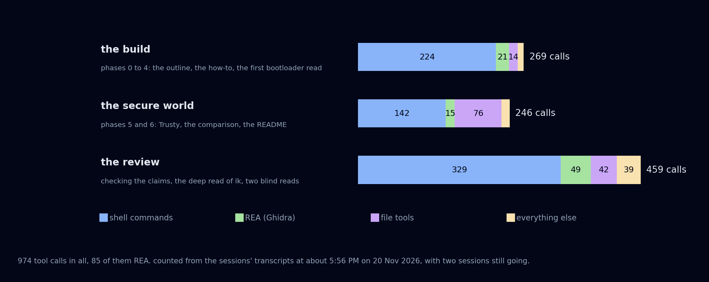

# how the code was read

most of this teardown is files unpacked and read with ordinary tools - `debugfs` into the vendor and system images, `avbtool` on vbmeta, `strings`, and the small scripts in [`tools/`](../tools/README.md). those reads each carry their own command in the [teardown](../Tab-A8-teardown.md), next to what they found.

the bootloader (`lk`) and the secure world (`trustos`) are different. they're raw ARM64 code with no headers and no symbol names - just megabytes of instructions. to read those, the teardown uses [REA](https://github.com/morluto/rea), which drives a [Ghidra](https://github.com/NationalSecurityAgency/ghidra) analysis engine: you open the raw image, tell it the CPU and the address it loads at (worked out first with [`tools/pin_base.py`](../tools/README.md)), then ask about functions by address. only a handful of functions in each image were read - the ones on the paths that answer a question - not the whole binary.

these are the REA tools that did it, grouped by what they're for; how many of each it took is in [the numbers](#the-numbers) at the foot.

## getting a file open

| tool | what it's for |
|---|---|
| `open_binary` | loads a raw image and analyses it. these blobs have no header, so you pass the architecture (`arm64`) and the load address, and then every reference lands on the right place |
| `close_binary` | frees the analysis engine when you're done. REA runs one engine at a time, so you close one image before opening the next |
| `binary_session` | reports what's open and which engine is available, without starting any analysis |

## reading a function

| tool | what it's for |
|---|---|
| `procedure_pseudo_code` | the workhorse - turns one function's machine code back into readable C-like pseudocode. this is what "reading a function" means here |
| `batch_decompile` | the same, for several functions at once |

## following the threads between functions

these are the cheap ones. a single function can be ten thousand characters; often you don't need to read it, just to know what it touches. these answer that without a full decompile.

| tool | what it's for |
|---|---|
| `procedure_callees` | lists the functions this one calls. the callees' names often say what a function does before you read a line of it - that's how the secure world's vbmeta handler was spotted as the AVB path |
| `procedure_callers` | lists what calls this function. "nothing calls it" is a real answer - it's how the dead-twin `0x9f1206d0` was caught |
| `xrefs` | every place in the code that touches one address - used to find everything that sets and reads the boot-state variable |
| `resolve_containing_procedure` | given any address (say, the code at a log string), the function it sits inside, and that function's size |

the pattern is always the same: `open` the image, `procedure_pseudo_code` to read a function, and the relationship tools to follow threads to the next function worth reading - so a question gets answered without decompiling the whole thing.

## reproducing it

the two images are carved from the stock BL bundle:

- `lk.body` is `lk-sign.bin` past its 512-byte DHTB header (`tail -c +513`), loaded at `0x9f000000`
- `tos-kernel.body` is the first `0xbc000` bytes of `tos-sign.bin`'s body (the Trusty kernel, before the packed apps), loaded at `0xffffffffe0000000`

both load addresses come from `tools/pin_base.py`. open either image at its address in REA and the function addresses named in the [teardown](../Tab-A8-teardown.md) resolve.

## the numbers

the repo was read across three Claude Code sessions, with a couple of helper agents along the way: **the build** (phases 0 to 4 - the bundles, the images, the signing chain, the first bootloader read), **the secure world** (phases 5 and 6 - the Trusty TEE, the comparison, the diagrams) and **the review** (the deep `lk` boot-path read). the commit authors show which did what.

**tool calls, per session** (helper agents included):

| session | shell | REA | file tools | everything else | total |
|---|---|---|---|---|---|
| the build | 224 | 21 | 14 | 10 | 269 |
| the secure world | 120 | 15 | 49 | 10 | 194 |
| the review | 117 | 42 | 9 | 22 | 190 |
| **all three** | **461** | **78** | **72** | **42** | **653** |

so **78 REA calls** read the bootloader and the secure world. REA is the small slice that does the actual decompiling; shell is the bulk, and most of that is little scripts that scan the whole image for "who jumps here" and "who reads this value" to find which functions are worth decompiling - the decompiler reads a function, the scripts pick which one. "file tools" is Read, Edit, Write, Grep and Glob; "everything else" is the diagram builds, coordination between the sessions, and the like.

the review session's 42 REA calls, as the shape of a decompile run: `procedure_pseudo_code` 11, `open_binary` 8, `close_binary` 8, `batch_decompile` 5, `resolve_containing_procedure` 4, `procedure_callers` 4, `binary_session` and `procedure_callees` 1 each (it decompiled 18 distinct `lk` functions). the 16 opens-and-closes are the shared-engine tax: REA runs one Ghidra at a time, so each read opens the image and closes it after.

**tokens, per session** (helper agents included):

| session | written | new input | re-read from cache |
|---|---|---|---|
| the build | 240k | 775k | 71.4M |
| the secure world | 267k | 561k | 48.9M |
| the review | 139k | 481k | 33.7M |
| **all three** | **646k** | **1.82M** | **154M** |

"written" is model output; "new input" is input plus cache-creation tokens; "re-read" is cache reads - the whole conversation read again every turn, which is why it dwarfs the rest.

*source and limits:* counted by a script (`tools/tool_calls_chart.py` draws the chart) from the three sessions' transcripts and their helper agents' - API-reported usage per message, de-duplicated by message id; tool-use blocks de-duplicated by id - at about 5:19 PM on 20 Nov 2026. all three sessions were still running then, so these are a snapshot and the real totals are a little higher. two short pre-fork stubs were left out so nothing is double-counted.

