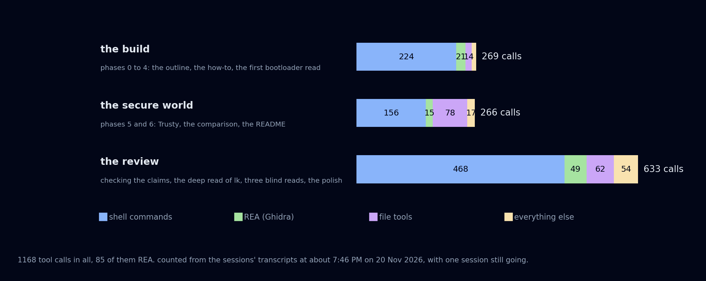
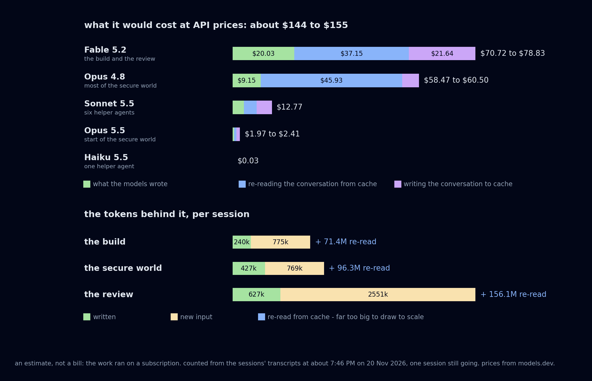

# what it took

building this repo - reading the firmware, writing it up, drawing the diagrams - ran across three Claude Code sessions and several helper agents. this page is the tool calls, the tokens, and what the same work would cost at API prices. how the reading itself was done is in [how the code was read](how-the-code-was-read.md).

the three sessions, with their helpers: **the build** (phases 0 to 4 - the bundles, the images, the signing chain, the first bootloader read), **the secure world** (phases 5 and 6 - the Trusty TEE, the comparison, the diagrams) and **the review** (a third session, the deep `lk` boot-path read, three blind reads of the finished repo, and the polish after them). the git history is authored under two models (Fable 5.2 and Opus 4.8); the finer five-model split below is from the transcripts, not the commit log.

**tool calls, per session** (helper agents included):

| session | shell | REA | file tools | everything else | total |
|---|---|---|---|---|---|
| the build | 224 | 21 | 14 | 10 | 269 |
| the secure world | 156 | 15 | 78 | 17 | 266 |
| the review | 468 | 49 | 62 | 54 | 633 |
| **all three** | **848** | **85** | **154** | **81** | **1,168** |

so **85 REA calls** read the bootloader and the secure world. REA is the small slice that does the actual decompiling; shell is the bulk, and most of that is little scripts that scan the whole image for "who jumps here" and "who reads this value" to find which functions are worth decompiling - the decompiler reads a function, the scripts pick which one. "file tools" is Read, Edit, Write, Grep and Glob; "everything else" is the diagram builds, coordination between the sessions, and the like.

the review session's 49 REA calls are all its own, the deep `lk` read (18 distinct functions decompiled) among them. its five helper agents, the blind readers included, made none - they read the repo, not the firmware. opens and closes are a big share of any such count: REA runs one Ghidra at a time, so each read opens the image and closes it after.

**tokens, per session** (helper agents included):

| session | written | new input | re-read from cache |
|---|---|---|---|
| the build | 239,885 | 774,808 | 71,435,720 |
| the secure world | 426,956 | 768,960 | 96,259,881 |
| the review | 627,216 | 2,550,591 | 156,069,795 |
| **all three** | **1,294,057** | **4,094,359** | **323,765,396** |

"written" is model output; "new input" is input plus cache-creation tokens; "re-read" is cache reads - the whole conversation read again every turn, which is why it dwarfs the rest.

**what it would cost at API prices.** the work ran on a Claude subscription, so this is an *estimate* - what the same tokens would run billed per-token on the pay-as-you-go API, not a bill:

| model | where it ran | estimated cost |
|---|---|---|
| Fable 5.2 | the build and the review sessions | $70.72 - $78.83 |
| Opus 4.8 | most of the secure-world session | $58.47 - $60.50 |
| Sonnet 5.5 | six helper agents | $12.77 |
| Opus 5.5 | the start of the secure-world session | $1.97 - $2.41 |
| Haiku 5.5 | one helper agent | $0.03 |
| **all** | | **$143.96 - $154.55** |

so **about $144 to $155** for the whole repo so far. almost all of it is the cache, not the thinking: at the high end, re-reading the conversation every turn is $88.01 and writing it to cache $33.17, against $33.36 of model output and about a cent of fresh input.

the prices, USD per million tokens, from [models.dev](https://models.dev) (`models show`, read 20 Nov 2026):

| model | input | output | cache read | cache write |
|---|---|---|---|---|
| Fable 5.2 | 8 | 40 | 0.2 | 10 |
| Opus 4.8 | 5 | 25 | 0.5 | 6.25 |
| Opus 5.5 | 4 | 20 | 0.2 | 5 |
| Sonnet 5.5 | 2 | 10 | 0.1 | 2.5 |
| Haiku 5.5 | 0.1 | 0.5 | 0.01 | 0.125 |

and the tokens behind it, per model (uncached input / output / cache read / cache write):

| model | uncached in | output | cache read | cache write |
|---|---|---|---|---|
| Fable 5.2 | 1,096 | 500,848 | 185,727,852 | 1,352,769 |
| Opus 4.8 | 448 | 365,811 | 91,854,082 | 542,882 |
| Opus 5.5 | 74 | 24,871 | 3,768,173 | 144,437 |
| Sonnet 5.5 | 672 | 366,253 | 41,777,663 | 1,970,862 |
| Haiku 5.5 | 30 | 36,274 | 637,626 | 81,089 |

*source and limits:* the calls and tokens were counted by a script (`tools/tool_calls_chart.py` draws the tool-call chart, `tools/cost_chart.py` the cost one) from the three sessions' transcripts and every helper agent's - API-reported usage per message, de-duplicated by message id; tool-use blocks de-duplicated by id - at about 7:46 PM on 20 Nov 2026, as one consistent run (a recount of an earlier 5:56 PM one). one session was still going then, so it's a snapshot and the real totals are a little higher. two short pre-fork stubs were left out so nothing is double-counted. the cost is an estimate at list prices, not a bill. its range is the cache-write price: models.dev lists one rate, so the low end prices every cache write at it, and the high end prices the three main sessions' writes at the one-hour-cache rate (twice the input price; the script does it per model, for Fable 5.2, Opus 4.8 and Opus 5.5, which comes to the same thing because every helper ran on Sonnet or Haiku) - that doubling is Anthropic's rule as best i understand it, but it wasn't verified on the day. all the arithmetic was done by a script, not by hand.
